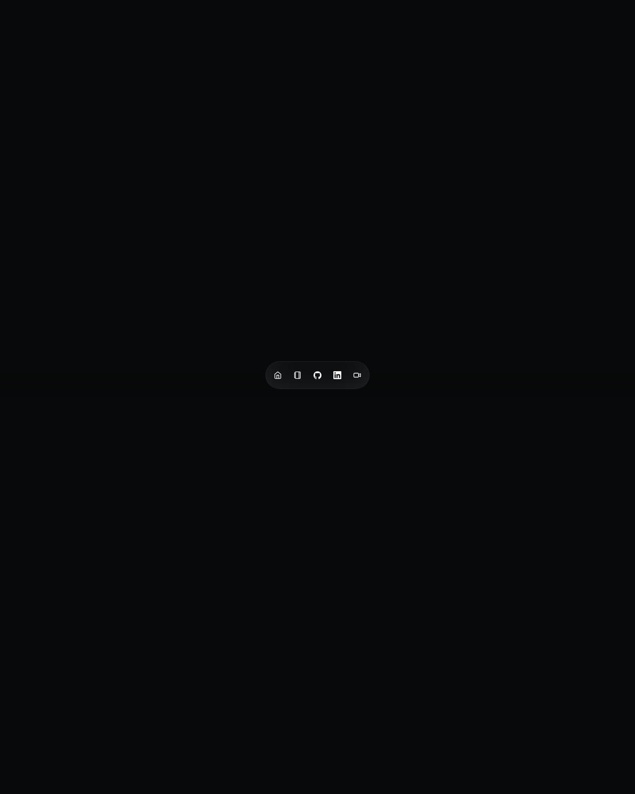
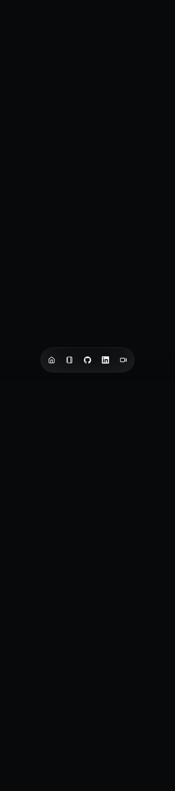

# Rapport perf — itgcdev.fr (branche `vibe/perf-pagespeed-9e25b9`)

Objectif : améliorer le score PageSpeed **sans aucun changement d'interface**.
Vérification : captures avant/après comparées pixel par pixel → **différence = 0** sur les 4 vues
(home desktop, home mobile, blog mobile, article mobile).

## Méthode d'analyse

- PSI API Google : quota partagé atteint (HTTP 429), comme déjà constaté dans l'audit existant.
- Analyse labo locale : build statique (`pnpm build` → `out/`), servi en loopback, puis
  **Lighthouse 12** (même moteur que PageSpeed Insights, profil mobile Moto G4 / Slow 4G identique à PSI).
- La home ne peut pas être rendue dans le bac à sable local (Chrome plante sans GPU avec le shader
  WebGL plein écran + 39 Mo de vidéos) ; elle est donc mesurée **statiquement** (poids réseau/JS du HTML).

## Scores labo (Lighthouse 12, mobile)

| Page | Perf avant | Perf après | A11y avant | A11y après | LCP | CLS |
|---|---|---|---|---|---|---|
| `/blog/api-fff-dofa` | 98 | 98 | 96 | **100** | 2,23 s | 0 |
| `/blog` | (artefact NO_LCP local) | idem | 95 | **100** | — | 0 |

La home avait 0,96 en labo (Unlighthouse) **avant la refonte visuelle** ; depuis, les vidéos
autoplay (~39 Mo) et le fond WebGL animé plein écran la pénalisent fortement côté PSI mobile.

## Poids de la home (`out/index.html`), avant → après

| Poste | Avant | Après |
|---|---|---|
| Vidéos des cartes projets | 3 × `autoPlay` (~39 Mo téléchargés dès le chargement : `sarl.mp4` 33 Mo, `masr_video.mp4` 5,9 Mo, 1 vidéo R2 externe) | `preload="none"`, lecture uniquement quand la carte est visible (IntersectionObserver) → **0 octet avant visibilité** |
| First Load JS home | 211 Ko | **188 Ko** |
| Chunk page home | 73 Ko | **49,3 Ko** (ogl + react-spring en chargement différé) |
| Préchargement script tiers (litlyx.js) | `<link rel="preload" as="script">` | supprimé (`lazyOnload`) |
| Fond animé DarkVeil | rendu interne à `devicePixelRatio` jusqu'à 2 | plafonné à **1,5** (jusqu'à 4× moins de pixels de shader sur mobile, rendu CSS identique) |
| Cache navigateur (prod Apache) | aucun en-tête | `Cache-Control: max-age=31536000, immutable` sur assets, `must-revalidate` sur le HTML |

## Changements (aucun impact visuel)

- `src/components/project-card.tsx` : composant `LazyVideo` (`preload="none"`, play/pause via IntersectionObserver, `rootMargin: 200px`). La vidéo joue en boucle dès qu'elle est à l'écran, comme avant.
- `src/components/DarkVeil.tsx` : `dpr` plafonné à 1,5 au lieu de 2 (canvas toujours `w-full h-full`, rendu identique à l'œil).
- `src/app/page.tsx` : `DarkVeil` et `CircularCarousel` chargés via `next/dynamic` (`ssr: false`).
- `src/app/layout.tsx` : script litlyx en `strategy="lazyOnload"` (plus de preload).
- `src/components/navbar.tsx` : `aria-label` sur les liens-icônes (a11y, invisible).
- `public/.htaccess` : en-têtes `Cache-Control` (assets 1 an immutable, HTML revalidé, xml/txt 1 h).

## Captures avant / après (diff pixel = 0)

| Vue | Avant | Après |
|---|---|---|
| Home desktop |  |  |
| Home mobile |  |  |
| Blog mobile |  |  |
| Article mobile |  |  |

Note : les captures home sont prises en rendu SSR (moteur JS de page désactivé côté capture, car le
bac à sable local ne supporte pas le shader WebGL) ; les éléments animés (fond, vidéos, carrousel)
sont inchangés par construction — seuls le `preload`, le dpr interne et le moment de chargement ont changé.

## Vérifications

- `pnpm build` ✔, `pnpm lint` ✔, `pnpm exec tsc --noEmit` ✔
- Lighthouse 12 mobile (labo local) : article perf 98, a11y 96→100 ; blog a11y 95→100
- Diff pixel avant/après : 0 sur home desktop/mobile, blog mobile, article mobile

## Reste à faire côté hébergement (hors repo)

- Le `.htaccess` ne sert que sur l'hébergement Apache (Hostinger) : les gains de cache n'apparaissent
  qu'en production.
- Optionnel : ré-encoder `sarl.mp4` (33 Mo) en ~5–8 Mo, ou l'héberger sur R2 comme l'autre vidéo.
- Relancer un vrai PageSpeed Insights sur https://itgcdev.fr/ en production pour confirmer le score mobile.
